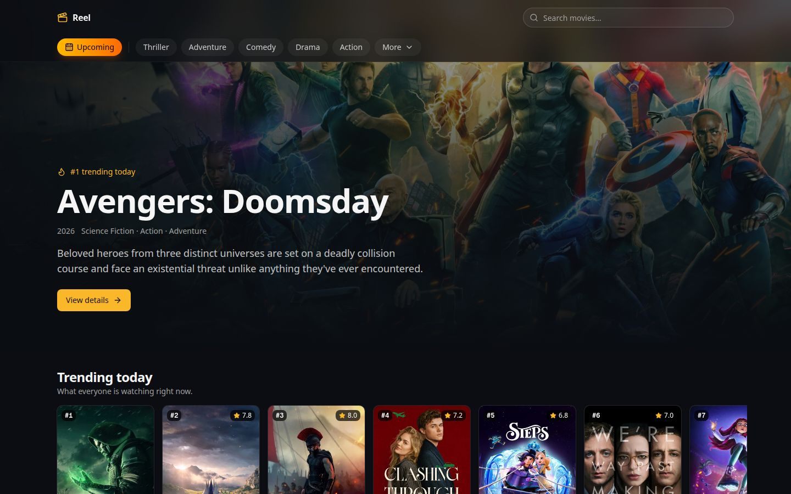
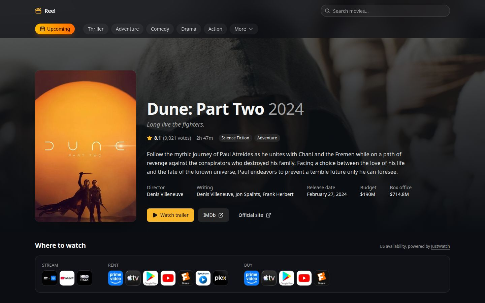

# Reel

[](https://github.com/miguelangarano/ordinal-interview/actions/workflows/ci.yml)

A movie discovery app built on the [TMDB API](https://developer.themoviedb.org/docs/getting-started): see what's trending today, browse by category, plan around upcoming releases, and dig into any movie.

**Live demo:** https://ordinal-interview.vercel.app



| Carousels by category | Movie details |
| --- | --- |
|  |  |
| **Upcoming release calendar** | **Clicking a day bursts its releases out** |
|  |  |

## Features

- **Home rows**: today's #1 movie gets a hero banner. Below it come carousels for Trending, Popular, and the five hottest categories. Each row pages left and right in groups and loads 10 more as you reach the end.
- **Categories**: the header shows the five genres most common in this week's trending movies, plus a **More** menu with the rest. A category page lists the top 50 movies and loads more as you scroll.
- **Upcoming**: a month-by-month release calendar showing every day of the month. Clicking a day bursts its movies out of the cell into a grid.
- **Movie details**: backdrop, rating, runtime, genres, credits, release info, trailer modal, cast with Wikipedia links, where to watch in your region (linked to each service), and recommendations.
- **Region**: a country picker in the header sets where-to-watch and the release calendar's dates. It defaults to the visitor's country (from Vercel's geo header) and remembers the choice in a cookie.
- **Search**: debounced and shareable (`/search?q=dune`), shows the top 50 results with more as you scroll, and returns home when you clear it.
- Server-rendered first paint, plus loading skeletons, error and not-found states, keyboard focus styles, and a reduced-motion fallback for the calendar animation.
- **Tested**: 52 unit tests (Vitest) and 14 end-to-end tests (Playwright, desktop and mobile). See [Testing](#testing).

## Running it locally

### Prerequisites

- **Node.js 20 or newer** (developed on Node 22)
- **pnpm 10 or newer**. If you don't have it: `corepack enable` or `npm install -g pnpm`.
- A free **TMDB account** for an API token

### 1. Get a TMDB token

1. Sign up at [themoviedb.org](https://www.themoviedb.org/signup).
2. Go to **Settings → API** ([direct link](https://www.themoviedb.org/settings/api)) and request an API key (choose "Developer"; any description is fine).
3. Copy the **API Read Access Token**: the long one that starts with `eyJ…`, not the shorter "API Key".

### 2. Configure and run

```bash
git clone https://github.com/miguelangarano/ordinal-interview.git
cd ordinal-interview

cp .env.example .env.local
# open .env.local and paste your token into TMDB_ACCESS_TOKEN=

pnpm install
pnpm dev
```

Then open **http://localhost:3000**.

> Using npm? `npm install && npm run dev` works too; pnpm is just what the lockfile is for.
> If pnpm warns about ignored build scripts, run `pnpm approve-builds` and allow `sharp`.

### Environment variables

| Variable | Required | Description |
| --- | --- | --- |
| `TMDB_ACCESS_TOKEN` | yes | Your TMDB "API Read Access Token", sent as a Bearer header |

If it's missing, the server fails on its first TMDB request with a message saying what to set. It's only read on the server and never reaches the browser.

### Scripts

| Command | What it does |
| --- | --- |
| `pnpm dev` | Start the dev server with Turbopack at http://localhost:3000 |
| `pnpm build` | Production build |
| `pnpm start` | Serve the production build (run `pnpm build` first) |
| `pnpm lint` | Lint with ESLint |
| `pnpm typecheck` | Type-check with TypeScript |
| `pnpm test` | Run the unit tests once |
| `pnpm test:watch` | Run the unit tests in watch mode |
| `pnpm test:e2e` | Build the app, start it, and run the end-to-end tests |

## Testing

### Unit tests (Vitest)

```bash
pnpm test
```

52 tests covering the logic most likely to break quietly:

- **Pagination windowing** (`movieWindow`): 10- and 50-item windows stitched from TMDB's 20-item pages, list ends, duplicates across pages, and TMDB's 500-page cap
- **Regional release dates:** picking a movie's local release day over its worldwide premiere
- **Region resolution:** saved cookie → geo header → US, and rejecting malformed values
- **Calendar month math:** month lengths, leap years, weekday offsets, crossing year boundaries
- **Wikipedia lookup** (with a mocked `fetch`): batching, malformed ids, and failing gracefully
- **Smaller helpers:** concurrency limiting, provider links, image URLs and runtimes

They run offline in about half a second.

### End-to-end tests (Playwright)

```bash
pnpm exec playwright install chromium   # first time only
pnpm test:e2e
```

14 tests run against a real production build (`pnpm build && pnpm start`, started for you). They cover:

- **Home:** the hero, row order matching the category bar, and Trending starting at 10 and loading 10 more at the end
- **Categories and More:** the top 50, then more on scroll
- **Search:** 50 results, and clearing returns home
- **Movie page:** trailer dialog (open and close with Escape), cast Wikipedia links, and the not-found page
- **Release calendar:** bursting a day open, focus returning to that day, and month navigation limits
- **Region picker:** cookie, where-to-watch label, and calendar
- **Phone width (Pixel 7):** no sideways page scroll, swipeable carousels, and the calendar

They use the real TMDB API, so `.env.local` needs a valid token. They check behavior and structure, not specific titles, since trending changes daily. To test a deployed site instead of a local build:

```bash
E2E_BASE_URL=https://ordinal-interview.vercel.app pnpm test:e2e
```

### CI/CD

[GitHub Actions](.github/workflows/ci.yml) runs on every push and pull request:

1. **Lint, typecheck & unit tests:** `pnpm lint`, `pnpm typecheck`, `pnpm test`
2. **End-to-end tests:** builds the app and runs the full Playwright suite. If a test fails, its trace is uploaded so you can step through what the browser saw.
3. **Deploy to production:** only for pushes to `main`, and only after both jobs above pass. It ships the commit to https://ordinal-interview.vercel.app with [`scripts/deploy-vercel.mjs`](scripts/deploy-vercel.mjs) and waits until it's live.

A red build never reaches production, and production always matches the latest green `main`. Pull requests and other branches get the checks but no deploy. Production deploys run one at a time, in order.

Repository settings it relies on:

| Name | Kind | Used by |
| --- | --- | --- |
| `TMDB_ACCESS_TOKEN` | secret | e2e tests |
| `VERCEL_TOKEN` | secret | deploy |
| `VERCEL_PROJECT_ID`, `VERCEL_ORG_ID` | variables | deploy |

## Stack

Next.js 15 (App Router) · React 19 · TailwindCSS 4 · tRPC 11 + TanStack Query · shadcn/ui (Radix) · Motion · zod · Vitest · Playwright

This mirrors Ordinal's stack where it applies. There's no database or background jobs, so Prisma and Inngest weren't needed.

## How it fits together

```
src/
  app/                routes: / , /movie/[id] , /search , /category/[id] , /upcoming
  components/         UI (shadcn primitives in components/ui)
  server/tmdb/        server-only TMDB client; responses validated with zod
  server/api/         tRPC router (movies.list / topGenres / upcoming / byId / …)
  server/wikipedia.ts resolves cast members to Wikipedia via Wikidata
  trpc/               client provider + RSC helpers (prefetch & hydrate)
  lib/                small shared helpers (images, dates, regions, provider links)
e2e/                  Playwright end-to-end tests
```

- **The TMDB token stays on the server.** The browser only talks to `/api/trpc`, never to TMDB directly.
- **Server first.** Server Components prefetch through the tRPC router and hydrate React Query, so the first rows render on the server and then load more on the client without a loading flash.
- **One list endpoint.** `movies.list` serves any window (offset + limit) over trending, popular, genre or search results by stitching TMDB's fixed 20-item pages together. That's how carousels load 10 at a time and grids load 50.
- **One request per movie.** `movies.byId` uses `append_to_response` to fetch details, credits, videos, recommendations and watch providers together, then shapes them into a smaller payload for the UI.
- **Non-blocking extras.** Cast Wikipedia links are looked up through Wikidata and streamed in with Suspense, so the page never waits on them. If Wikipedia is unreachable, the links are simply left out.
- **Region-aware without per-request parameters.** The region is resolved once per request in the tRPC context (cookie → `x-vercel-ip-country` → US), so procedures just read `ctx.region`. For the calendar, TMDB's discover endpoint finds movies releasing in that country, but it returns each movie's worldwide premiere date. So each movie's local release date is looked up, with at most 16 requests in flight, and cached for a day.
- **Caching.** TMDB responses go through Next's fetch cache (15 min for trending, 1 h for details, 24 h for genres). Images load straight from TMDB's CDN, which already serves them at the requested size.
- **Validated at the edges.** TMDB responses and all tRPC inputs are parsed with zod, so unexpected data fails loudly in one place instead of deep in the UI.

## Deploying

Production deploys are automatic (see [CI/CD](#cicd)). Every green push to `main` goes live on Vercel. The production build reads `TMDB_ACCESS_TOKEN` from the Vercel project's environment variables.

To deploy by hand (e.g. to your own Vercel project):

```bash
VERCEL_TOKEN=… VERCEL_PROJECT_ID=prj_… VERCEL_ORG_ID=team_… node scripts/deploy-vercel.mjs
```

The script uses Vercel's REST API instead of the Vercel CLI, so it also works with project-scoped tokens, which the CLI rejects. Any Node host works too: set `TMDB_ACCESS_TOKEN`, then run `pnpm build && pnpm start`.

## What I'd do next

- **Watchlist:** sign in, save movies to a watchlist (Postgres via Prisma), and get reminded when something on it is released or starts streaming in your region (scheduled with Inngest).

---

This product uses the TMDB API but is not endorsed or certified by TMDB.
