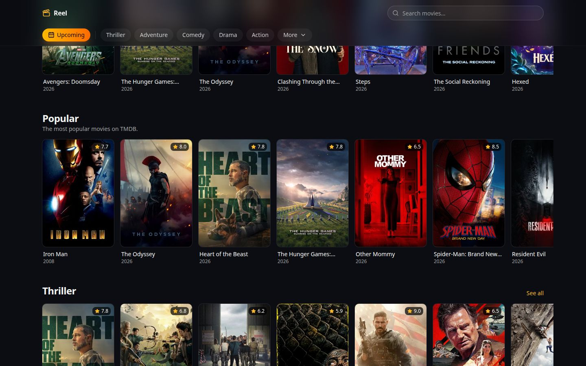
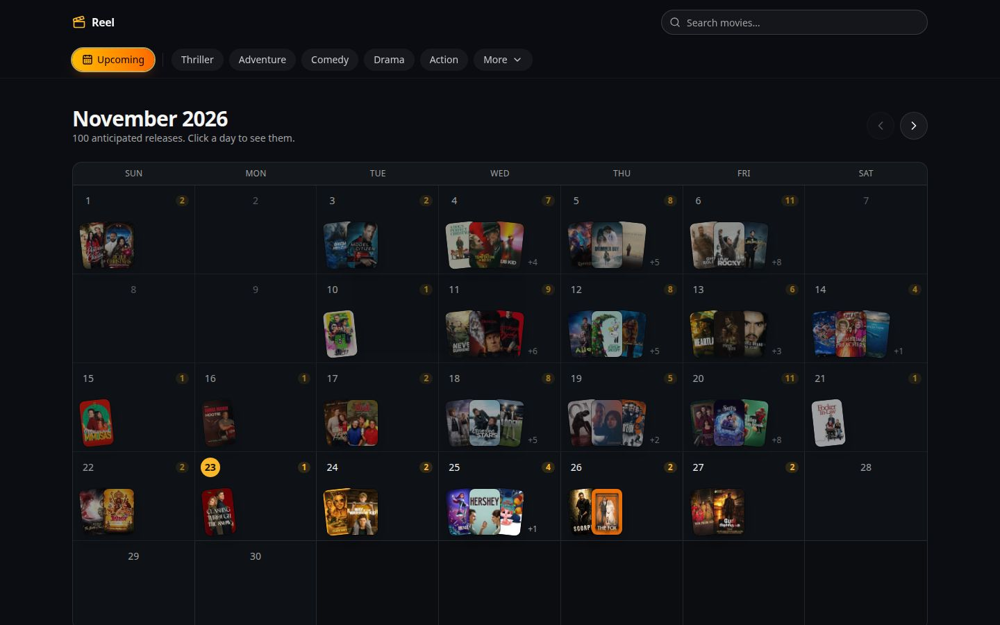
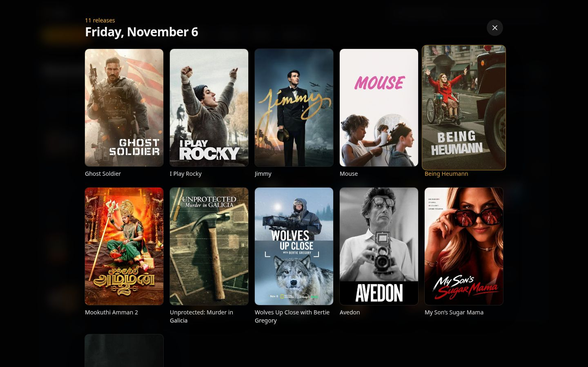

# Reel

A movie discovery app built on the [TMDB API](https://developer.themoviedb.org/docs/getting-started): see what's trending today, browse by category, plan around upcoming releases, and dig into any movie.

**Live demo:** https://ordinal-interview.vercel.app


| Carousels by category | Movie details |
| --- | --- |
|  |  |
| **Upcoming release calendar** | **Clicking a day bursts its releases out** |
|  |  |

## Features

- **Home rows**: today's #1 movie gets a hero banner. Below it come carousels for Trending, Popular, and the five hottest categories. Each row pages left and right in groups and loads 10 more as you reach the end.
- **Categories**: the header shows the five genres most common in this week's trending movies, plus a **More** menu with the rest. A category page lists the top 50 movies and loads more as you scroll.
- **Upcoming**: a month-by-month release calendar showing every day of the month. Clicking a day bursts its movies out of the cell into a grid.
- **Movie details**: backdrop, rating, runtime, genres, credits, release info, trailer modal, cast with Wikipedia links, where to watch in the US (linked to each service), and recommendations.
- **Search**: debounced and shareable (`/search?q=dune`), shows the top 50 results with more as you scroll, and returns home when you clear it.
- Server-rendered first paint, plus loading skeletons, error and not-found states, keyboard focus styles, and a reduced-motion fallback for the calendar animation.

## Running it locally

### Prerequisites

- **Node.js 20 or newer** (developed on Node 22)
- **pnpm 10 or newer**. If you don't have it: `corepack enable` or `npm install -g pnpm`.
- A free **TMDB account** for an API token

### 1. Get a TMDB token

1. Sign up at [themoviedb.org](https://www.themoviedb.org/signup).
2. Go to **Settings → API** ([direct link](https://www.themoviedb.org/settings/api)) and request an API key (choose "Developer"; any description is fine).
3. Copy the **API Read Access Token** (the long one that starts with `eyJ…`). The shorter **API Key** works too.

### 2. Configure and run

```bash
git clone https://github.com/miguelangarano/ordinal-interview.git
cd ordinal-interview

cp .env.example .env.local
# open .env.local and paste your token into TMDB_ACCESS_TOKEN=

pnpm install
pnpm dev
```

Then open **http://localhost:3000**.

> Using npm? `npm install && npm run dev` works too; pnpm is just what the lockfile is for.
> If pnpm warns about ignored build scripts, run `pnpm approve-builds` and allow `sharp`.

### Environment variables

| Variable | Required | Description |
| --- | --- | --- |
| `TMDB_ACCESS_TOKEN` | one of these two | TMDB v4 "API Read Access Token" (preferred), sent as a Bearer header |
| `TMDB_API_KEY` | one of these two | TMDB v3 "API Key", sent as a query parameter |

If neither is set, the server fails on its first TMDB request with a message saying which variables to set. Both are only read on the server and never reach the browser.

### Scripts

| Command | What it does |
| --- | --- |
| `pnpm dev` | Start the dev server with Turbopack at http://localhost:3000 |
| `pnpm build` | Production build |
| `pnpm start` | Serve the production build (run `pnpm build` first) |
| `pnpm lint` | Lint with ESLint |

## Stack

Next.js 15 (App Router) · React 19 · TailwindCSS 4 · tRPC 11 + TanStack Query · shadcn/ui (Radix) · Motion · zod

This mirrors Ordinal's stack where it applies. There's no database or background jobs, so Prisma and Inngest weren't needed.

## How it fits together

```
src/
  app/                routes: / , /movie/[id] , /search , /category/[id] , /upcoming
  components/         UI (shadcn primitives in components/ui)
  server/tmdb/        server-only TMDB client; responses validated with zod
  server/api/         tRPC router (movies.list / topGenres / upcoming / byId / …)
  server/wikipedia.ts resolves cast members to Wikipedia via Wikidata
  trpc/               client provider + RSC helpers (prefetch & hydrate)
  lib/                small shared helpers (images, dates, provider links)
```

- **The TMDB token stays on the server.** The browser only talks to `/api/trpc`, never to TMDB directly.
- **Server first.** Server Components prefetch through the tRPC router and hydrate React Query, so the first rows render on the server and then load more on the client without a loading flash.
- **One list endpoint.** `movies.list` serves any window (offset + limit) over trending, popular, genre or search results by stitching TMDB's fixed 20-item pages together. That's how carousels load 10 at a time and grids load 50.
- **One request per movie.** `movies.byId` uses `append_to_response` to fetch details, credits, videos, recommendations and watch providers together, then shapes them into a smaller payload for the UI.
- **Non-blocking extras.** Cast Wikipedia links are looked up through Wikidata and streamed in with Suspense, so the page never waits on them. If Wikipedia is unreachable, the links are simply left out.
- **Caching.** TMDB responses go through Next's fetch cache (15 min for trending, 1 h for details, 24 h for genres). Images load straight from TMDB's CDN, which already serves them at the requested size.
- **Validated at the edges.** TMDB responses and all tRPC inputs are parsed with zod, so unexpected data fails loudly in one place instead of deep in the UI.

## Deploying

Any Node host works. On Vercel: import the repo, add `TMDB_ACCESS_TOKEN` as an environment variable, and deploy. The defaults (`pnpm build`) need no extra configuration.

## What I'd do next

- **Tests:** unit tests for the pagination windowing and month helpers, plus a Playwright smoke test of the main flows. I checked those flows by hand in a headless browser, but they aren't automated yet.
- **Watchlist:** user accounts and a watchlist (a good fit for Prisma), and reminders for upcoming releases (a good fit for Inngest).
- **Region:** pick the region for "where to watch" and release dates instead of assuming the US.

---

This product uses the TMDB API but is not endorsed or certified by TMDB.
